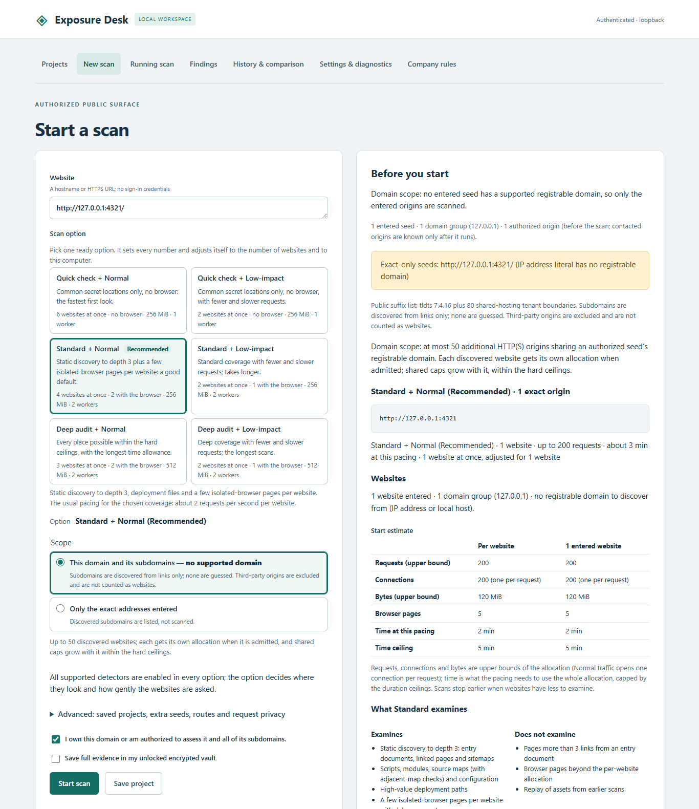
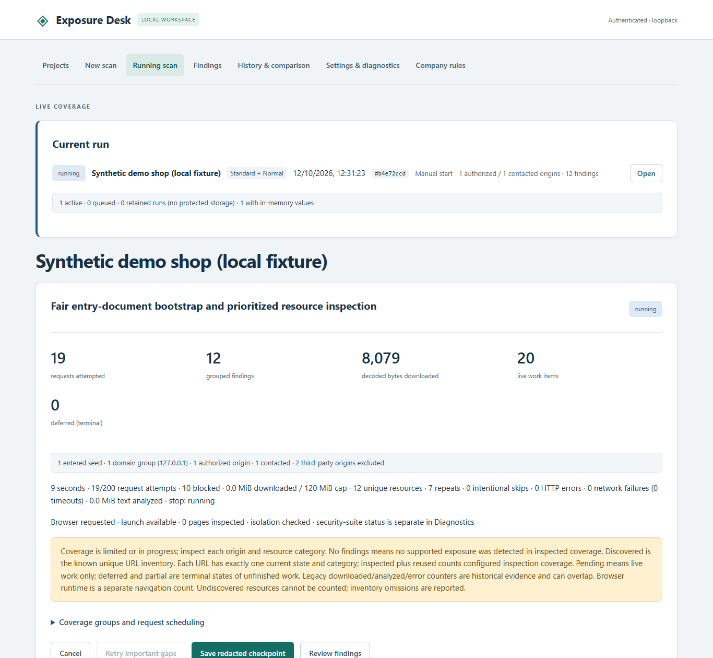
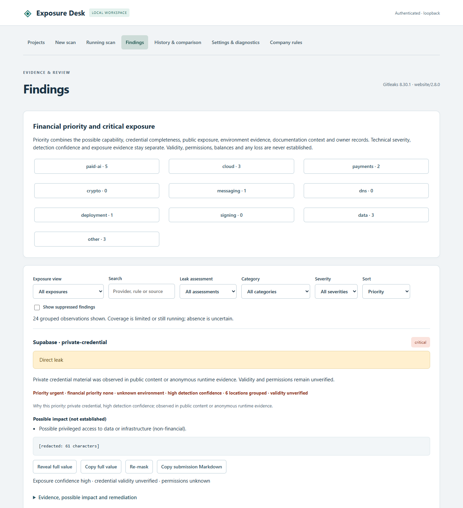
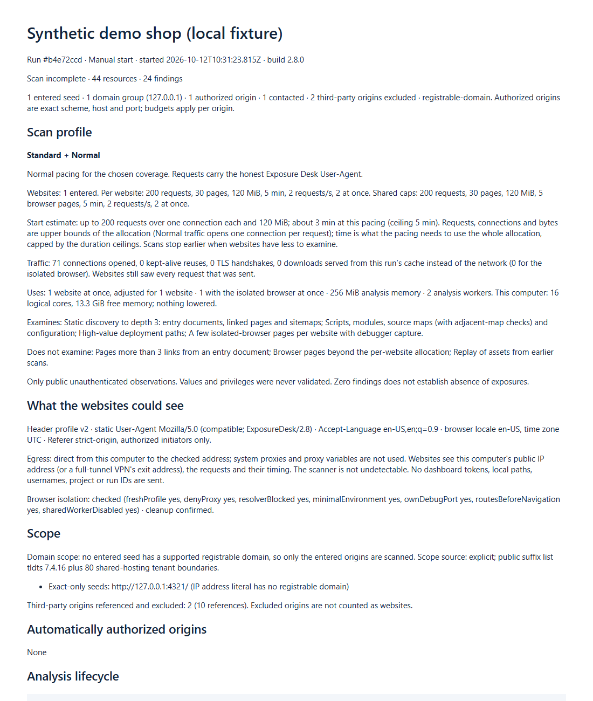
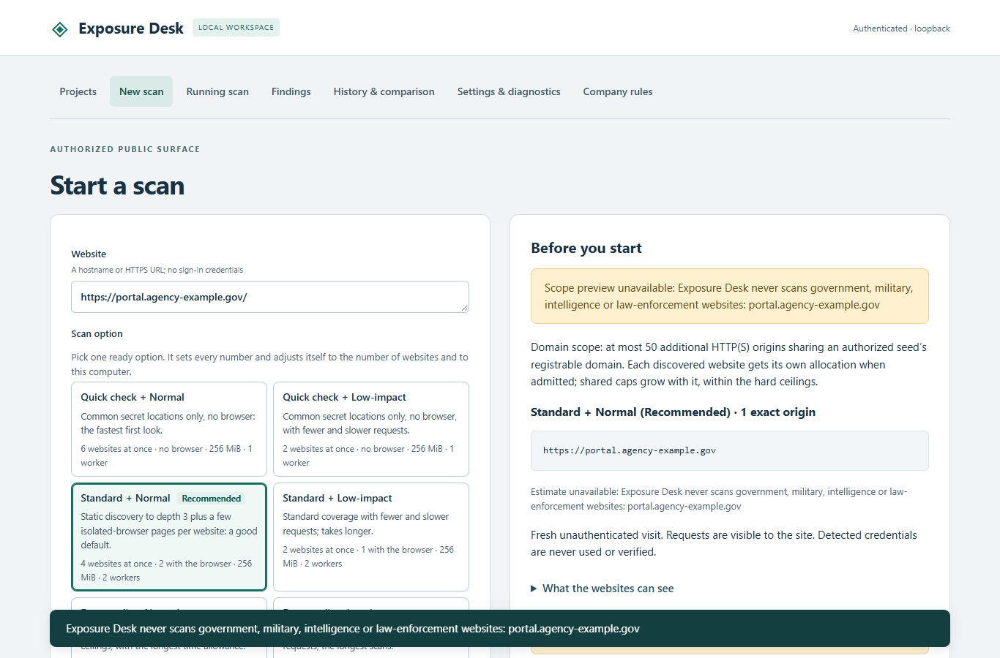

# Exposure Desk: overview and reference

The short introduction is in the [README](../README.md). This page is the long version: who it is for, the bug bounty workflow, safety, every feature, measured results, limitations, versions and the technical reference.

**A local, privacy-first scanner that finds secrets your own websites expose to the public.**

Exposure Desk visits a website you own or are authorized to assess, the way an anonymous visitor would, and looks for credentials and private data that the site serves by mistake: API keys in JavaScript bundles and source maps, passwords in configuration files left on the server, signing secrets in page data, wallet keys, database URLs and similar material. It runs entirely on your computer, shows where each finding came from and how urgent it is, and tells you how to fix it.

Current version: **2.9.1** (Windows x64 and Linux x64), a patch release of 2.9.0. It has been verified only with local test fixtures and synthetic keys, not on real websites (see [Measured results](#measured-results) and [Status](#status-and-versions)).

## Who it is for

- **Website owners and small teams** who want to know, before someone else finds out, whether their public site leaks a key. No security background is needed: pick the Recommended scan option, enter the website, confirm you are authorized, and start.
- **Developers and DevOps engineers** who want a check before and after deployment: an offline build-folder gate (`artifacts`), a deployment trigger and SARIF output for code-scanning dashboards.
- **Security staff and consultants** assessing sites they are authorized to test, who need evidence with exact locations, priorities and a masked report.
- **Bug bounty hunters** working from the command line, Linux first: a program file that holds the program's scope, target lists from tools such as httpx, concurrent and resumable runs, recon lists and masked submission drafts. Start with the [Bug bounty quick start](#bug-bounty-quick-start).

It is not a tool for scanning websites you do not control or are not authorized to assess, and it refuses government, military and law-enforcement websites outright (see below).

## Bug bounty quick start

For researchers who run Exposure Desk from the command line against the assets of a program they joined. In the commands, `exposure-desk` stands for the command line of your install (there is no separate `exposure-desk` command); placeholder names such as `example.com` stand for your program's assets.

**1. Install** ([docs/LINUX.md](LINUX.md)).

- **Linux x64 package:** `sha256sum --check "Exposure Desk <version> Linux x64.tar.gz.sha256"`, then `tar -xzf "Exposure Desk <version> Linux x64.tar.gz"`. In the unpacked folder, `exposure-desk` is `runtime/bin/node dist/src/cli.js`.
- **Container image:** `docker build --tag exposure-desk .` in a checkout of this repository, then `docker run --rm -i -v exposure-data:/data exposure-desk …` with the locked-down flags shown in [docs/LINUX.md](LINUX.md#container-image). The working directory is the `/data` volume, so keep program folders, state files and outputs there; a target list can come in on standard input (`--targets -`).
- **Windows x64 package:** extract `Exposure Desk <version> Windows x64.zip`. In the extracted folder, `exposure-desk` is `runtime\node.exe dist\src\cli.js`.

**2. Describe the program** ([docs/PROGRAM.md](PROGRAM.md)). Either write a commented template or import the scope file you downloaded from the platform (offline; nothing is fetched). Neither replaces an existing `program.json`:

```sh
exposure-desk program init programs/example-program
# or, from the scope file you downloaded:
# exposure-desk program import --platform hackerone-csv --file scope.csv programs/example-program
exposure-desk program check programs/example-program
```

Fill in or review `scope.in` and `scope.out`, the request rate and any identification headers the program asks for, then run `program check`. The import never sets `"authorized": true`: read the program's policy, then set it yourself or pass `--authorized` on every run.

**3. Run the authorized target list** ([docs/MASS_SCAN.md](MASS_SCAN.md), [docs/RECON.md](RECON.md), [docs/SUBMISSION.md](SUBMISSION.md), [docs/JSONL.md](JSONL.md)). `hosts.txt` holds one host name, URL or httpx-style line per line:

```sh
mkdir -p runs
exposure-desk scan --targets hosts.txt --authorized --program programs/example-program \
  --concurrency 4 --state runs/example.state --recon runs/recon \
  --submission-bundle runs/submissions --jsonl --silent > runs/example.jsonl
```

- `--program` applies the program's scope (out-of-scope lines are rejected, out-of-scope links are never requested), its request rate and its headers to every target.
- `--concurrency 4` runs four targets at once (the program file's default; at most 16 without a program file and 64 with one).
- `--state` makes the list resumable: after an interruption, run the same command again with `>>` instead of `>`. Finished targets are skipped; a changed list or setting is refused before any request.
- `--recon` writes masked recon lists (URLs, endpoints, hosts by scope, parameters, scripts, source maps, GraphQL) per target plus a merged set.
- `--submission-bundle` writes one masked submission Markdown draft per finding, plus an `index.md`, at the end of the run. `--format md` writes each target's report as one masked submission Markdown file instead of JSON, and `exposure-desk report submit REPORT.json … --bundle DIR` builds drafts later, offline, from saved JSON reports.
- `--jsonl` streams one JSON object per event for `jq` or a results database, for example `jq -c 'select(.event=="finding" and (.duplicateOf|not))' runs/example.jsonl` for each exposure once.

**Hard rules.** No flag, setting or program file changes these:

- **Protected hosts.** Government, military, intelligence, law-enforcement, judiciary and intergovernmental-organization hosts are refused on every target line and every request, with no override.
- **Authorization.** Scan only assets you are authorized to test. A list with more than one accepted target needs `--authorized`; with a program file, every run needs `--authorized` or `"authorized": true` in the file. A program file only narrows the scope; it never widens it.
- **No evasion.** The User-Agent stays honest (a program's suffix is appended, never a replacement), and there is no fingerprint faking and no IP or proxy rotation. A blocked target is stopped, never retried around.
- **Scans never send found keys.** No scan, mass scan or ready option sends a found key to its provider or anywhere else, or tests it. The only exception is the opt-in live key check (2.9): off unless a program file turns it on, started by a person for one finding at a time, one read-only identity request to that key's own provider ([docs/LIVE_KEY_CHECK.md](LIVE_KEY_CHECK.md)).
- **Data stays local.** No account, cloud service, telemetry or upload.
- **Masked by default.** `--full-secrets` unmasks values only in report files written to disk; the terminal, JSON Lines and recon lists always stay masked.

The full rules are in [ACCEPTABLE_USE.md](../ACCEPTABLE_USE.md); the step-by-step guide is in [USER_GUIDE.md](../USER_GUIDE.md#bug-bounty-workflow-280).

## Why it is safe to run

- **Everything stays on your machine.** Scans, findings, history and the optional vault are stored locally in a protected data folder. There is no account, no cloud service, no telemetry, no remote AI model and no report upload.
- **Scans never use found keys.** No scan ever sends a discovered credential to its provider, logs in with it, or triggers paid usage; findings state "validity not established". A found key leaves your machine only if a person explicitly runs a live key check on one finding — off by default, opt-in per program, a single read-only identity request to that key's own provider. Many programs forbid using found credentials; read the program rules first. See [docs/LIVE_KEY_CHECK.md](LIVE_KEY_CHECK.md).
- **Secrets are masked by default.** History, exports, checkpoints and the dashboard show masked values. Revealing or copying a full value is a deliberate, authenticated action that re-masks itself; a full-value export must be chosen explicitly.
- **Guarded transport.** Every request, from the plain HTTP client and from the isolated browser, passes one scope policy before it leaves: authorized origins only, DNS answers checked and the socket pinned to the checked address, TLS validated, private and cloud-metadata addresses blocked, redirects rechecked, and outgoing URLs, headers and bodies screened so that no found secret can be sent anywhere.
- **Isolated browser.** Pages that need JavaScript are opened in a dedicated Chromium with a fresh profile for every visit. Its traffic goes through the same guarded transport; WebSockets, service workers, WebRTC, downloads and other unmanaged channels are disabled. Forms are never submitted and nothing is clicked.
- **Honest, gentle traffic.** Requests carry an honest product token and are rate-limited per website. The Low-impact option is slower still. There is no spoofing, evasion timing, proxy rotation or rate-limit bypass.
- **Protected hosts, no override.** Exposure Desk never sends any request to a government, military, intelligence or security-service, law-enforcement, judiciary or intergovernmental-organization website. No setting, flag or environment variable turns this off.
- **Local dashboard hardening.** The dashboard listens only on loopback, requires a launch token, and uses HttpOnly SameSite=Strict cookies, CSRF protection, Host/Origin checks and a restrictive Content Security Policy.

What is stored and what leaves your computer is described in [PRIVACY.md](../PRIVACY.md). Use Exposure Desk only on websites you own or are authorized to assess; the rules are in [ACCEPTABLE_USE.md](../ACCEPTABLE_USE.md).

## Key features

- **Six ready scan options (new in 2.6).** Choose a Coverage (Quick check, Standard or Deep audit) and a Traffic level (Normal or Low-impact). **Standard + Normal is Recommended** and is the default everywhere. Each option sets every number; a read-only "What this option uses" panel shows them, and an estimate line says how many websites run at once and roughly how long the scan takes.
- **Automatic sizing for the websites and the computer.** At scan start Exposure Desk reads the number of websites, the CPU cores and the free memory, and only ever lowers values. Analysis memory never exceeds 512 MiB, for the parser workers and the engine's large-text workers together.
- **Low-impact traffic.** About 0.5 requests per second and one kept-alive connection per website, no retries and a small run cache, for fragile or rate-limited sites.
- **Deep discovery.** HTML, scripts and lazy modules, CSS, JSON and configuration files, framework build manifests and hydration data, source maps with embedded sources, TypeScript, well-known deployment paths, and (Standard and Deep audit) isolated-browser pages with debugger capture of generated scripts. Discovery follows the entered domain and its subdomains by default (public suffix list, provider tenant suffixes respected).
- **Wide detector coverage.** Provider-specific rules for AI, cloud, payment, messaging, DNS, deployment and developer platforms; wallet seed phrases, private and extended keys; JWK and PGP private keys; application signing secrets; passwords in database and service URLs; webhook capability URLs. A pinned, offline Gitleaks 8.30.1 engine adds its rule catalogue. Placeholders and templates such as `${VAR}` are filtered out. See [DETECTOR_COVERAGE.md](../DETECTOR_COVERAGE.md).
- **Findings you can act on.** Each finding shows its provider, exact location (including the original file through a source map), how it was decoded or reconstructed, confidence, a priority with its reason, a separate financial priority, possible impacts (never claimed as established), qualifiers such as "test environment" or "published example", and provider-specific remediation steps.
- **Incident tracking.** Removal, owner-confirmed revocation and rescan tracks per finding; masked alerts for new or reappeared values; comparisons between scans that say when absence is uncertain; scoped, expiring suppressions with an audit trail.
- **Honest coverage reporting.** Every scan says what it could not inspect and why (time or size limits, errors, browser gaps, profile boundaries). An incomplete scan is never shown as complete, and "no findings" is never presented as proof that a site is clean.
- **Automation.** Saved projects, a local queue, schedules that run while the app is open, deployment triggers from a build step on the same computer, a CLI with JSON, HTML, SARIF and submission-Markdown output and CI-friendly exit codes, and an offline build-folder check.
- **Opt-in live key check (new in 2.9).** With a program file that allows it, a person can ask whether one found key still works: one read-only identity request to that key's own provider (GitHub, GitLab, OpenAI, Anthropic, Stripe, SendGrid or Slack), recorded as live, revoked or unknown next to the finding. Off by default and never part of a scan. See [docs/LIVE_KEY_CHECK.md](LIVE_KEY_CHECK.md).
- **Bug bounty workflow (new in 2.8).** Program files with scope rules, a program-wide request rate and identification headers; concurrent, resumable target lists that stop on blocks instead of evading them; masked recon lists and source-map rebuilds into an owner-only folder; masked submission Markdown from the CLI and the dashboard; a Linux x64 package and a container image. See the [Bug bounty quick start](#bug-bounty-quick-start).
- **Optional encrypted vault.** Full values can be kept across restarts only if you deliberately save them to a password-protected vault (AES-256-GCM, scrypt key derivation).
- **Local company rules.** Up to 30 declarative RE2 patterns for your own internal token formats, previewed locally.

## Screenshots

All screenshots show a synthetic demo shop served by the built-in local test fixture on `127.0.0.1`; no real website was scanned and every secret-looking value is a non-functional test vector. A 2–3 minute walkthrough is in [DEMO.md](../DEMO.md). To regenerate the images, see the header of `scripts/screenshots.mjs`.

| | |
| --- | --- |
|  |  |
| **Start a scan.** Six ready options; the start estimate shows requests, bytes and time before anything is sent. | **Running scan.** Live counters, per-origin budgets and coverage state. |
|  |  |
| **Findings.** Values are masked (`[redacted: N characters]`) until you deliberately reveal one; validity is never tested. | **Report.** The default export is redacted: scan profile, what the websites could see, scope and findings. |
|  | |
| **Protected-host rule.** Government, military, intelligence and law-enforcement websites are refused before any DNS lookup, with no override. | |

## Quick start

**Windows (portable package).** Extract `Exposure Desk 2.9.1 Windows x64.zip` and double-click **Start Exposure Desk.cmd**. Keep the launch window open. Your default browser opens the local dashboard; paste the token printed in the launch window into **Launch token** and click **Open workspace**. The package bundles Node 24.18.1, the locked npm modules, Gitleaks 8.30.1 and Chrome for Testing 153.0.8010.12, so nothing else needs to be installed or downloaded. It is a large download (about 275 MB) because of the dedicated browser.

**First scan.**
1. Open **Settings** and click **Run full-pipeline self-test** to confirm the detector and the isolated browser work on this computer (it uses local synthetic fixtures only).
2. Open **New scan**, enter your website, leave **Standard + Normal (Recommended)** selected, confirm that you own the website or are authorized to assess it, and click **Start scan**.
3. Follow **Running scan**, then review **Findings**. Start with the urgent and high-priority findings and follow each one's remediation steps.

**Command line.**

```text
node dist/src/cli.js help
node dist/src/cli.js scan --url https://www.example.com/ --output reports/site.json
node dist/src/cli.js scan --url https://www.example.com/ --coverage quick --traffic low-impact --format sarif --output reports/site.sarif
node dist/src/cli.js artifacts --directory build
```

(In the Windows package, use `runtime\node.exe` in place of `node`.) Exit code 0 means the configured checks completed without unsuppressed private credentials, 1 means they completed with such findings, and 2 means the scan failed, was cancelled, was incomplete or was refused. A website address whose host is not valid is refused before any request with exit 2 (see [MIGRATION_2.7.md](../MIGRATION_2.7.md#website-addresses)); in a `--targets` list such a line is rejected and the other lines continue.

**From source.** `npm ci`, `npm run build`, `npm run launch`. The source launcher can download an official Node 24.18.1 archive with SHA-256 verification if no compatible Node is installed; the detector and browser are installed from **Settings**. Installation traffic comes only from official software sources and is separate from scan traffic.

**Linux.** The Linux x64 package and the container image are described in [docs/LINUX.md](LINUX.md). A source checkout starts with `sh "Start Exposure Desk.sh"` and Node.js 24–26 from `PATH`. What has been tested on Linux is listed under [Limitations](#limitations); macOS and ARM are not supported yet.

The full walk-through is in [USER_GUIDE.md](../USER_GUIDE.md).

## Measured results

All numbers below come from the project's own verification records ([TEST_RESULTS.md](../TEST_RESULTS.md), [HANDOFF.md](../HANDOFF.md) and the internal work handoffs). They were measured on one Windows x64 computer, against local loopback fixtures and synthetic, nonfunctional keys. **No real website was scanned for these measurements, and they make no claim about accuracy or speed on real websites.**

**2.9.0 (build `2.9.0+b251a3ea63449d85`)**

| Check | Result |
| --- | --- |
| Non-browser regression tests | 761/761 passed |
| Browser and UI regression tests | 46/46 passed in the final full run; 44/46 in a sanity run under heavy outside load, and both failing tests passed when run again alone (see Test timing under Limitations) |
| Repeated Chromium cancellation stress | 60/60 passed |
| Selected provider corpus with the pinned engine | 167/167 targets detected, 0 false positives (130 in 2.8.0, plus the new providers) |
| Full acquisition pipeline | 17/17 fixtures |
| Detection families with executable fixture evidence | 88/88 (60 in 2.8.0) |
| Frozen 2.5 corpus, legacy configurations, 3 repetitions each on 2.8.0 and 2.9.0 | 60/60 runs without errors |
| Legacy 2.4 corpora | 13/13 credentials and 5/5 data exposures with 0 false positives on 2.9.0, equal to the 2.8.0 release records; dynamic application 5/5 |
| Ready options on local fixtures | 191/191 acceptance checks met over 33 scans on 2.9.0, against the 24 2.8.0 rows reused from the 2.8.0 release records after a same-day spot check (see below) |
| Target lists at scale (mass scan, loopback fixtures) | 7 measurements: 200 targets on 50 loopback origins at 1, 4, 16 and 64 at once, and 16 large-bundle targets at 1, 4 and 16 at once. Every planted key found, every 200-target run completed every target, one 256 MiB analysis budget never exceeded, 0 non-loopback connections; 2238 s one at a time, 592 s at 4, 207 s at 16 and 173 s at 64 with a program file (2.8.0: 2272, 618, 234 and 206 s; see below) |
| External synthetic corpus | 12/12 runs equal to 2.8.0 for every site's state, findings, misses and false positives |
| Live key check | Tested only against loopback stand-ins for its seven providers; no real provider endpoint was contacted |
| Linux x64 on GitHub-hosted Ubuntu runners | 760/761 non-browser tests passed (the one Windows-only test skipped) and 46/46 browser and UI tests passed on the release run 38684371332 (and on the earlier run 38638887840) on this build; the Linux x64 package was built and passed its smoke test on the runner, but its upload failed because the repository's artifact storage was full; the container image was built |
| Extracted Windows package smoke test | 13/13 checks, including the analysis processes on the bundled runtime |

**2.8.0 (build `2.8.0+cc5fecf8cb75f1c7`)**

| Check | Result |
| --- | --- |
| Non-browser regression tests | 654/654 passed |
| Browser and UI regression tests | 40/40 passed on each full-suite run (see Test timing under Limitations) |
| Repeated Chromium cancellation stress | 60/60 passed |
| Selected provider corpus with the pinned engine | 130/130 targets detected, 0 false positives |
| Full acquisition pipeline | 17/17 fixtures |
| Detection families with executable fixture evidence | 60/60 |
| Frozen 2.5 corpus, legacy configurations, 3 repetitions each on 2.7.0 and 2.8.0 | 54/54 runs without errors |
| Legacy 2.4 corpora | 13/13 credentials and 5/5 data exposures with 0 false positives on 2.8.0, equal to the 2.7.0 release records; dynamic application 5/5 |
| Ready options on local fixtures | 191/191 acceptance checks met over 57 scans (24 on 2.7.0, 33 on 2.8.0) |
| Target lists at scale (mass scan, loopback fixtures) | 7 measurements with 200 targets on 50 loopback origins (1, 4, 16 and 64 at once, two resume tests, one block test): every target completed at each setting, every planted key found, one 256 MiB analysis budget never exceeded, 0 non-loopback connections; 2272 s one at a time, 618 s at 4, 234 s at 16 and 206 s at 64 with a program file (see below) |
| Linux x64 on GitHub-hosted Ubuntu runners | 653/654 non-browser tests passed (the one Windows-only test skipped) and 40/40 browser and UI tests passed on each of three runs on this build; the Linux x64 package was built and passed its smoke test on the runner, and the container image was built |
| Extracted Windows package smoke test | 13/13 checks, including the analysis processes on the bundled runtime |

The 2.7.0 figures and earlier ones are in [TEST_RESULTS.md](../TEST_RESULTS.md) and `benchmarks/history/`. 2.9.0 re-measured the external corpus, target lists at scale and the frozen 2.5 corpus (on the extracted 2.8.0 Windows package and on 2.9.0) and the 2.9.0 side of the ready-option matrix. Two 2.8.0 baselines were reused by owner decision (2026-10-11) instead of re-measured: the 2.8.0 rows of the ready-option matrix, taken from the 2.8.0 release records after a same-day spot check of 6 rows on the extracted 2.8.0 Windows package (`benchmarks/2.9.0/matrix-reuse.json`), and the 2.8.0 side of the legacy 2.4 corpora (`benchmarks/2.8.0/`), whose evaluation scripts and corpora have not changed since then.

**Ready options on 10 websites, in-scope keys found**

| Coverage | 2.5.0-rc.1 (legacy preset, measured for 2.6.0-rc.1) | 2.8.0 (2.8.0 release records) | 2.9.0 |
| --- | --- | --- | --- |
| Quick check | 32/80 | 60/80 | 60/80 |
| Standard | 40/80 | 70/80 | 70/80 |
| Deep audit (2.5: Thorough) | 68/80 | 80/80 | 80/80 |

On 2.9.0, Low-impact traffic opened 10 TCP connections for Quick check on 10 websites (Normal: 250), 18 for Standard (Normal: 490) and 29 for Deep audit (Normal: 529), equal to 2.8.0, and Deep audit + Low-impact kept Deep audit + Normal's recall. The matrix also ran 9 scans on 2.9.0 with an injected small computer (2 logical cores, 1.0 GiB free memory). All 191 acceptance checks were met, no row was stale or failed, and no 2.9.0 row was more than 15 % slower than its 2.8.0 row. The spot check re-ran 6 of the 24 reused rows on the extracted 2.8.0 Windows package the same day: 5 matched the records in state, keys, connections and memory settings with time within 15 %; the browser row (Standard + Normal on 10 websites) ran twice and gave 489 and 490 requests (record 490) and 2 and 1 parser processes (record 2), so its differences are within the variance of the same build. Memory figures are under Memory in Limitations.

**External synthetic corpus.** A corpus written by a separate, non-Claude AI and reviewed before use: 20 sites, 27 private values and 402 negative controls, the same files as for 2.6, 2.7 and 2.8. On 2.9.0, with every expected file seeded, every ready option found all 27 with 3 false positives (precision 0.900, recall 1); from the site root only, Standard and Deep audit found 27 of 27 and Quick check 24 of 27 (the other 3 are in resources Quick check does not examine). Low-impact traffic found the same as Normal, and nothing left the loopback addresses. Each site's state, findings, misses and false positives equal the 2.8.0, 2.7.0 and 2.6.0-rc.1 measurements. The 3 false positives are deliberate policy cases (two Stripe test-mode keys and one documentation example, which Exposure Desk reports at lower priority instead of hiding). Before the fixes that followed this corpus's review, the same measurement was 19 found, 3 false positives, 8 missed.

**Target lists at scale.** `scripts/mass-scan-measure.mjs` scanned 200 synthetic targets on 50 loopback origins (127.0.0.1 to 127.0.0.50) with Quick check, Normal traffic and `--state`, one measurement at a time on one Windows computer. One target at a time took 2238 s (4400 requests, 2.0 per second, scan process at most 204 MiB), 4 at once 592 s (7.4 per second, 309 MiB), 16 at once 207 s (21.2 per second, 329 MiB) and 64 at once with a program file 173 s (25.4 per second, 357 MiB; the memory gate held a target start 32 times); 2.8.0 took 2272, 618, 234 and 206 s. Every run completed all 200 targets with 4400 requests and found every planted key (200 per-target and 50 shared keys), the one 256 MiB analysis budget was never exceeded, no analysis process ran out of memory and nothing left the loopback addresses. With the program file the program's request limiter set the pace; since 2.9.0 it serves waiting requests in arrival order, and the longest wait for a request slot fell from 24 s to 3.1 s (see Speed under Limitations). With 16 targets that each serve their own 1.25 MB bundle (Standard check), the scan process stayed at 379–390 MiB at 1, 4 and 16 at once, where the 2.8.0 code reached 557–577 MiB above one at a time. The resume and block measurements of 2.8.0 were not repeated; the tests cover them. See [docs/MASS_SCAN.md](MASS_SCAN.md).

## Limitations

- **No real-website trial yet.** 2.9.1 has been verified with local fixtures only; it has not yet been run by the owner on their own websites.
- **Synthetic evidence only.** All measurements use local fixtures and synthetic keys on one Windows x64 computer, with single-digit repetitions and no statistical controls; the Linux figures come from the CI workflow on GitHub-hosted runners.
- **Platforms.** Windows x64 was measured on one computer. Linux x64 was tested only on GitHub-hosted Ubuntu runners (both test suites, the package build with its smoke test and the container build; pass/fail results without timing or memory figures); other Linux distributions are unverified. macOS and ARM are not supported yet.
- **Not proof of absence.** Zero findings, access barriers or an incomplete scan do not show that a website is secure. Authenticated areas, images, encrypted archives, executable obfuscation and code that is never referenced are not covered. Values built at run time by functions such as `String.fromCharCode` are seen only by the browser, not by static analysis.
- **Validity is not established by a scan.** Scans never send keys to providers, so a finding cannot say whether a key still works or what it can do. The opt-in live key check (2.9) can ask the provider for one key at a time, only for the seven providers with a recipe and only where a program file allows it; its answer is stored beside the finding, whose `validity` stays `unverified`.
- **Speed.** Analysis takes about 0.6 seconds per resource, so large scans are bounded by analysis rather than by traffic limits. A target list shares that analysis: 200 Quick check targets took 2238 s one at a time, 592 s at 4, 207 s at 16 and 173 s at 64 with a program file. With a program file and many targets waiting, the program's request limiter granted about 25 requests per second against its nominal 50 on this computer; since 2.9.0 it serves waiting requests in arrival order (the longest wait for a request slot was 3.1 s, against 24 s in 2.8.0), and the wait does not use a target's time allowance, so it costs wall time only (see Target lists at scale above).
- **Memory.** The analysis memory setting (at most 512 MiB) is one budget for the heaps of the parser workers and the engine's large-text workers. Each worker runs in its own process and holds its heap limit from the budget until that process has ended, and analysis waits for memory rather than going over. A worker that reaches its heap limit ends alone: the scan continues and states the limit. A large-text worker's heap is sized to its text; a whole-script analysis that would not fit the setting is skipped with a stated limit, and the window results are kept. A text over 128 KiB that is checked in the scan process itself (browser snapshots, supplied bodies) gets window checks only, never a whole-document parse. The setting does not cover the scan process, each worker process's own runtime (about 40–56 MiB), the isolated browser or the engine process. With a local 1.25 MB bundle fixture the scan process peaked at 248–318 MiB, and the scan process with its worker processes at 400–475 MiB (sampled). Before the workers moved into their own processes these figures were 385–431 MiB and 381–470 MiB, and 2.6.0 testing once reached 533 MiB, before the large-text workers counted against the setting. In the 2.7.0 ready-option matrix the scan process peaked at 245–318 MiB on that fixture (2.6.0, whose analysis ran inside the scan process: 366–412 MiB); the scan process's peak plus the peaks of its analysis processes, added together, was at most 693 MiB, an upper bound rather than memory used at one moment. In the 2.8.0 matrix the scan process peaked at 248–334 MiB on that fixture (2.7.0, measured the same day: 247–314 MiB), and the scan peak plus its analysis-process peaks was at most 707 MiB (2.7.0: 707 MiB); 65 analysis processes started, with at most 512 MiB of heap limits at once (256 MiB on the small computer) and none out of memory. In the 2.9.0 matrix the scan process peaked at 280–324 MiB on that fixture (2.8.0 records: 248–334 MiB), and the scan peak plus its analysis-process peaks was at most 740 MiB (2.8.0 records: 707 MiB); 65 analysis processes started, with at most 512 MiB of heap limits at once (256 MiB on the small computer) and none out of memory. In a target list the scan process holds every running target's state, outside the analysis setting: 204 MiB one target at a time, 309 MiB at 4, 329 MiB at 16 and 357 MiB at 64 with a program file, and 379–390 MiB with 16 targets that each serve a 1.25 MB bundle; above 1 at once a memory gate holds back the next target while the scan process is short of room under 512 MiB, and since 2.9.0 the scan process runs a full memory collection after large in-process parses add up.
- **Test timing.** In 2.6.0 two browser tests each failed once under load because requests waited behind the detector's engine lane, which polled instead of queueing. 2.7.0 queues the engine and large-text lanes first come, first served; since then `test/repair-browser.test.ts` passed every repeated run (12 of 12, and 3 of 3 after the analysis processes moved out), and on the 2.7.0 build the full browser suite passed 34 of 34 on both runs (see [TEST_RESULTS.md](../TEST_RESULTS.md)). Every 2.6.0 attempt is listed in `benchmarks/2.6.0/browser-attempts.json`. On the 2.8.0 build the full browser suite passed 40 of 40 on both runs on the Windows computer (`benchmarks/2.8.0/browser-attempts.json`). Four timing causes that the Linux CI runs found during 2.8 development (the analysis time factor used before it was measured, queue wait charged to the analysis allocation, Linux timers firing up to 1 ms early at a deadline, and late browser captures) and three later non-browser timer races (two timers per request, a website limit timer that ran without a clock check, and the scan's and the website's clocks read at two instants) were fixed before the release build (see [CHANGELOG_2.8.md](../CHANGELOG_2.8.md)). On the 2.9.0 build the final full suites passed 761 of 761 and 46 of 46 on the Windows computer. In sanity runs under heavy outside load (an unrelated CPU-bound job at 95 % CPU or more), two browser tests failed because Chrome did not confirm its exit within the 3 s cleanup bound and one target-list test hit its analysis-turn limit; each passed when run again alone (`benchmarks/2.9.0/browser-attempts.json`).
- **Scope edge cases.** Shared-hosting providers that are on neither the public suffix list nor the built-in list of 80 tenant suffixes keep the wider registrable domain. The protected-host list is not exhaustive: unlisted public bodies on ordinary domains, bare IP addresses and plain-HTTP DNS aliases are not recognized.
- **Policy choices.** Test-mode keys and documentation examples are reported (at lower priority) rather than hidden.

## Status and versions

- **2.9.1** (build `2.9.1+94a512df50bb9d43`, rules `website/2.9.1`): a patch release. The semantic pass follows webpack's cross-module constant exports, so a key split across webpack modules of one downloaded file is found (bounded by the existing semantic budget, with the gap `semantic-webpack-budget` when the bound is reached); the screening of requests in a mass run takes fair turns; `invalid-url` refusals are informational and no longer make a scan incomplete; mass runs at concurrency 1 (`--state`) report memory; and the Linux package is delivered as an asset of a draft GitHub Release. No format rule changed, and every 2.9.0 flag, configuration, program file and saved record keeps working. See [CHANGELOG_2.9.1.md](../CHANGELOG_2.9.1.md).
- **2.9.0** (build `2.9.0+b251a3ea63449d85`, rules `website/2.9.0`): an opt-in live key check for one finding at a time (off unless a program file turns it on; one read-only identity request to the key's own provider), 31 format rules for 28 further providers ported from Gitleaks and Nosey Parker, host validation for every discovered URL, `politie.be` and `policia.pt` on the protected-host list, a stronger page-leave guard (document rewrites, removed frames, popups and late requests), lower scan-process memory in mass runs with large bundles, fair program-wide request turns and the shared wait split by cause in JSON Lines. The ready options and their limits, Low-impact traffic, masking and the protected-host and authorization rules are unchanged, and every 2.8 flag, configuration, program file and saved record keeps working. See [CHANGELOG_2.9.md](../CHANGELOG_2.9.md) and [MIGRATION_2.9.md](../MIGRATION_2.9.md).
- **2.8.0** (build `2.8.0+cc5fecf8cb75f1c7`, rules `website/2.8.0`): opt-in features for bug bounty work on the command line: program files with scope rules, a program-wide request rate and identification headers (`program init`, `check` and `import`); target lists that run concurrently under one analysis memory budget, resume after an interruption (`--state`) and stop on blocks instead of evading them; masked recon lists, a rebuild of public source maps into an owner-only folder and masked submission Markdown; and a Linux x64 package and container image beside the Windows package. The detection rules, the ready options and their limits, Low-impact traffic, masking and the protected-host and authorization rules are unchanged, and every 2.7 flag, configuration and saved record keeps working. See [CHANGELOG_2.8.md](../CHANGELOG_2.8.md) and [MIGRATION_2.8.md](../MIGRATION_2.8.md).
- **2.7.0** (build `2.7.0+3772c88c496661b5`, rules `website/2.7.0`): target lists (`scan --targets`), JSON Lines output (`--jsonl`) and stable finding IDs (`--program`) on the command line, stricter checks of website addresses, and script analysis in separate processes under one analysis memory setting. The detection rules, the ready options and the protected-host rule are unchanged, and every 2.6 flag, configuration and saved record keeps working. See [CHANGELOG_2.7.md](../CHANGELOG_2.7.md) and [MIGRATION_2.7.md](../MIGRATION_2.7.md).
- **2.6.0** (build `2.6.0+8b02299c3915954b`, rules `website/2.6.1`): the final 2.6 release. Everything in 2.6.0-rc.1 plus a detection-quality update from a comparison with other open-source secret scanners: a shared placeholder filter, 17 new rules (13 prefix and URL rules such as Docker Hub, Figma, Tailscale, Vercel, Firecrawl, Jina, Tavily, Google OAuth, Square, Braintree and Cloudinary, and 4 rules for passwords in FTP, mail, message-broker and LDAP URLs), Discord and Zapier webhook URLs, decoding of character-encoded JSON in HTML attributes, an offline GitHub token checksum and richer SARIF; plus fixes for undecodable files in the offline build-folder gate and for browser profiles left by interrupted scans. See [CHANGELOG_2.6.md](../CHANGELOG_2.6.md).
- **2.6.0-rc.1** (build `2.6.0-rc.1+43dc0e2d6c36202f`, rules `website/2.6.0`): ready scan options, automatic sizing, Low-impact traffic, the protected-host rule and fixes from an external review. See [UPGRADE_2.6.md](../UPGRADE_2.6.md), [MIGRATION_2.6.md](../MIGRATION_2.6.md) (older settings keep their numbers until you switch) and [CHANGELOG_2.6.md](../CHANGELOG_2.6.md).
- **2.5.0-rc.1:** domain scope by default, explained runs, incident records with financial priority, wallet and signing-key checks, alerts and deployment triggers. See [UPGRADE_2.5.md](history/UPGRADE_2.5.md), [MIGRATION_2.5.md](history/MIGRATION_2.5.md) and [CHANGELOG_2.5.md](history/CHANGELOG_2.5.md).
- **Earlier:** 2.4 adaptive allocations, incremental dependency analysis and TypeScript/source-map support ([UPGRADE_2.4.md](history/UPGRADE_2.4.md)); 2.3.1 reliability repair ([MIGRATION_2.3.1.md](history/MIGRATION_2.3.1.md)); Milestone 1 fair origin scheduling and Exhaustive coverage ([MILESTONE1.md](history/MILESTONE1.md)).

## Documentation

| Document | What it covers |
| --- | --- |
| [USER_GUIDE.md](../USER_GUIDE.md) | Step-by-step use of the dashboard, scan options, findings, projects, the command line, the bug bounty workflow and the protected-host rule |
| [MIGRATION_2.9.md](../MIGRATION_2.9.md) | Moving from 2.8 to 2.9: nothing breaks; the opt-in live key check, new rules, new JSON Lines fields and the behaviour changes you may notice |
| [MIGRATION_2.8.md](../MIGRATION_2.8.md) | Moving from 2.7 to 2.8: nothing breaks; new options, JSON Lines fields, resume, the analysis time factor, Linux and the container image |
| [docs/PROGRAM.md](PROGRAM.md) | Program files: scope rules, program-wide rate and concurrency, identification headers, `program init`, `check` and `import` |
| [docs/LIVE_KEY_CHECK.md](LIVE_KEY_CHECK.md) | Opt-in per-finding "Check if live": off by default, program-gated, one key at a time, read-only, and the supported providers |
| [docs/MASS_SCAN.md](MASS_SCAN.md) | Concurrent target lists, `--state` resume, block detection and cross-target de-duplication |
| [docs/RECON.md](RECON.md) | Recon lists (`--recon`), source-map rebuild (`--rebuild-sources`) and recon downloads in the dashboard |
| [docs/SUBMISSION.md](SUBMISSION.md) | Masked submission Markdown: `--format md`, `--submission-bundle`, `report submit` and the dashboard copy button |
| [docs/LINUX.md](LINUX.md) | Linux x64 package, container image, browser sandbox and analysis time on slow machines |
| [docs/JSONL.md](JSONL.md) | The JSON Lines events written by `scan --jsonl` |
| [MIGRATION_2.7.md](../MIGRATION_2.7.md) | Moving from 2.6 to 2.7.0: what keeps working, new command-line options and behaviour changes |
| [UPGRADE_2.6.md](../UPGRADE_2.6.md) | Exact behaviour and limits of the ready options, sizing and Low-impact traffic |
| [MIGRATION_2.6.md](../MIGRATION_2.6.md) | Moving to 2.6.0: older settings keep their stored numbers until you switch |
| [TEST_RESULTS.md](../TEST_RESULTS.md) | Full measured verification for 2.9.1 and 2.9.0 (earlier releases in `benchmarks/history/`) |
| [CHANGELOG_2.9.1.md](../CHANGELOG_2.9.1.md) | Every change in 2.9.1 |
| [CHANGELOG_2.9.md](../CHANGELOG_2.9.md) | Every change in 2.9.0 |
| [CHANGELOG_2.8.md](../CHANGELOG_2.8.md) | Every change in 2.8.0 |
| [CHANGELOG_2.7.md](../CHANGELOG_2.7.md) | Every change in 2.7.0 |
| [CHANGELOG_2.6.md](../CHANGELOG_2.6.md) | Every change in 2.6.0 |
| [docs/history/](history/) | Upgrade notes, migrations and changelogs of 2.5 and earlier |
| [DETECTOR_COVERAGE.md](../DETECTOR_COVERAGE.md) | Every supported provider and format, with limits and official references |
| [THIRD_PARTY.md](../THIRD_PARTY.md) | Dependencies, versions, licences and adapted rule sources |
| [HANDOFF.md](../HANDOFF.md) | Release handoff: verified results, known gaps and open items |
| [RELEASE_PACKAGE.md](../RELEASE_PACKAGE.md) | Package contents and verification |
| [PRIVACY.md](../PRIVACY.md) | What is stored, where, and what leaves your computer |
| [ACCEPTABLE_USE.md](../ACCEPTABLE_USE.md) | Permitted use: own or authorized websites only, the protected-host block, no evasion |
| [SECURITY.md](../SECURITY.md) | How to report a vulnerability, supported versions and scope |
| [DEMO.md](../DEMO.md) | A 2–3 minute demo script on the synthetic local fixture |
| [LICENSE](../LICENSE) | Exposure Desk's own licence (proprietary, all rights reserved, view only) |

---

# Technical reference

## Ready scan options

| Option | Examines | Traffic per website | Websites at once | Browser websites at once | Analysis memory | Analysis workers | Download cap / website | Time allowance / website |
| --- | --- | --- | --- | --- | --- | --- | --- | --- |
| Quick check + Normal | Entry documents, their first-party scripts and source maps, build and web app manifests, robots.txt and high-value deployment paths. No browser and no crawl. | About 2 requests/s | 6 | none | 256 MiB | 1 | 40 MiB | 2 min |
| Quick check + Low-impact | Same as Quick check + Normal | About 0.5 requests/s, one kept-alive connection | 2 | none | 256 MiB | 1 | 40 MiB | 8 min |
| **Standard + Normal (Recommended)** | Static discovery to depth 3, deployment paths and a few isolated-browser pages | About 2 requests/s | 4 | 2 | 256 MiB | 2 | 120 MiB | 5 min |
| Standard + Low-impact | Same as Standard + Normal, with fewer browser pages and no adjacent source-map guessing or extra query-string variants | About 0.5 requests/s, one kept-alive connection | 2 | 1 | 256 MiB | 2 | 120 MiB | 20 min |
| Deep audit + Normal | Full static discovery (depth 5), browser routes with debugger capture, adjacent source maps, query variants and adaptive allocations | About 2 requests/s | 3 | 2 | 512 MiB | 2 | 300 MiB | 60 min |
| Deep audit + Low-impact | Same as Deep audit + Normal, with fewer browser pages and no adjacent source-map guessing or extra query-string variants | About 0.5 requests/s, one kept-alive connection | 2 | 1 | 512 MiB | 2 | 300 MiB | 60 min |

Quick check ends as "completed — quick coverage", which never means the site has no secrets. Low-impact makes no retries and visits one query-string variant per path; a Standard or Deep audit Low-impact scan whose only unvisited work is those variants ends as completed and is labelled "Limited by profile". Low-impact does not hide the scan: websites still see every request, this computer's IP address and the honest User-Agent.

**Automatic adjustment (always on, only lowers values).** Websites at once never exceed the websites in scope; further websites wait for a free slot, and each website's time allowance starts with its own first request. Shared caps (pages, requests, bytes and total time) grow with the number of websites, within the hard ceilings. Under 4 logical cores or about 2 GiB free memory a scan uses 1 analysis worker and 1 browser website; analysis memory stays within a quarter of the free memory. Every lowered value is shown on the scan page and kept in the report and the scan record. An estimate over about 2 hours is named, with Quick check suggested; nothing switches automatically.

**Ceilings.** 512 MiB analysis memory for all parser and large-text worker heaps together, 8 websites and 4 browser websites at once, 12 requests at once and 20 requests/s. A JSON configuration file, CLI `--config` file, saved project or scan start with a higher value is refused before any request.

**Older settings.** Projects and configuration files from earlier versions keep their stored numbers and are never re-mapped silently. They show as **Legacy preset: X**, **Custom (from an older version)** or **Custom (based on …)**, with a one-click **Switch to …** to the closest ready option. Power users can still upload JSON scan specifications under New scan → Advanced.

## Legacy presets

Legacy presets (2.5 and earlier) still load and run exactly as stored, and the CLI keeps `--preset quick|standard|thorough|exhaustive|custom`:

| Preset | Pages / attempts | Duration | Decoded resource / total inspection cap | Checks |
| --- | --- | --- | --- | --- |
| Quick | 8 / 60 | 90 seconds | 8 / 40 MiB | Static, referenced maps, no adjacent guesses |
| Standard | 30 / 200 | 5 minutes | 12 / 120 MiB | Browser requested: 5 pages, 2 scroll steps |
| Thorough | 80 / 600 | 15 minutes | 24 / 300 MiB | Browser requested: 15 pages, 5 scroll steps; finite deployment-file checks |
| Exhaustive | 80 / 600 shared | Up to 60 minutes per admitted origin; project ceiling depends on origin count | 24 / 300 MiB shared | Thorough resource safeguards; 3 HTTP/origin, 2/s/origin, 4 active HTTP origins, 12 HTTP globally, 2 browser origins |
| Custom | Hard maximum 500 / 2000 | Maximum 60 minutes | Maximum 32 MiB/resource, 500 MiB total | Explicit bounded settings |

Legacy presets keep 2 project requests/second and concurrency 2; per-origin concurrency is bounded to 8 and global HTTP concurrency to 12. See [MILESTONE1.md](history/MILESTONE1.md) for the Exhaustive and per-origin settings.

## Discovery and analysis

Discovery covers HTML and comments, referenced scripts and lazy modules, CSS, JSON and configuration, web app and framework build manifests (Vite modulepreload, Next.js build manifests and chunk paths, recoverable Webpack ID/hash filename tables, Nuxt hydration, Astro islands), public API responses, source maps (indexed sections, embedded sources, cycle/depth/count limits) and bounded fresh browser DOM, configuration and storage. Arbitrary bundler code is never evaluated, so complex dynamic references can remain undiscovered.

Bounded percent, Base64, hex and escape decoding, static literal concatenation and constant references keep the original source representation and each transformation step. Texts over 128 KiB are inspected in overlapping 64 KiB windows; scripts up to 2 MiB are also parsed once so that provider context survives in large bundles. Locations distinguish generated code, extracted sources, approximate reconstructions and runtime snapshots; no line number is ever invented.

Robots exclusions are respected by default; Advanced can select an owner-authorized public-surface audit. Up to 10 selected read-only browser navigation URLs stay within approved origins and browser page limits. No forms, arbitrary clicks, purchases, AI generation or credential validation.

## Security model

All requests, map sections, framework assets, jobs and schedules use one scope policy (exact approved origins plus, in domain scope, admitted subdomains of the entered domains), pre-transmission URL, header and body screening, all-answer DNS checks, socket IP pinning and verification, dashboard-port isolation, TLS validation, method restrictions, budgets and redirect rechecks. Cloud metadata addresses stay blocked even with a private-origin approval. Proxy environment variables are not used: websites see this computer's public IP (or a full-tunnel VPN's exit address). Static requests carry an honest product token and the configured language; browser requests keep Chromium's own User-Agent with the configured language and time zone; Referer is reduced to the origin. The scanner is not undetectable.

Chromium always uses a fresh dedicated protected profile. Routed page, worker and frame traffic uses the guarded Node transport, with a deny-only proxy for missed channels. Cookies are host-only and sent only from a page of their own origin. WebSockets, service workers, WebRTC/WebTransport/direct sockets and downloads are disabled. No browser sandbox override and no connection to your personal browser.

The dashboard uses loopback launch-token authentication, HttpOnly SameSite=Strict cookies, CSRF protection, Host/Origin/Sec-Fetch checks, a restrictive CSP, anti-framing and no-store headers, and inert evidence rendering. No secrets, scanner state, paths, user names or project identifiers are injected into scanned sites.

### Hard rule: protected hosts (no override)

Exposure Desk never sends any request to a government, military, intelligence or security-service, law-enforcement, judiciary or intergovernmental-organization website.

- **Refused scans:** a scan is refused as a whole if the website, an extra seed, a related or private origin, a browser navigation URL, a read-only POST endpoint or a stale-asset URL names such a host. The message is "Exposure Desk never scans government, military, intelligence or law-enforcement websites: <host>". The CLI exits 2, and the dashboard shows the message.
- **Saved work:** saved projects, queued scans, schedules and deployment triggers that name such a host show the reason and never run. Their stored records are kept as they are.
- **During a scan:** links, redirects, assets, images, sitemaps, source maps, WebSockets and browser requests to a protected host are skipped before any DNS lookup or connection, and counted as "refused (never scanned)".
- **No override:** no setting, flag, environment variable, preset, profile or dashboard control turns this off.

[USER_GUIDE.md](../USER_GUIDE.md#hard-rule-protected-hosts) lists what is blocked and the known limits.

## Data, history and the vault

Data defaults to `%LOCALAPPDATA%\Exposure Desk` on Windows or `$XDG_DATA_HOME/exposure-desk` (normally `~/.local/share/exposure-desk`) on Linux. Set `EXPOSURE_DATA_DIR` (an absolute path) before launch to use another operator-owned folder. Windows ACL or POSIX private permissions are required.

All scans keep redacted progress and findings when protected storage is available; interrupted runs recover as incomplete. History holds redacted findings metadata, configuration, coverage, timestamps and engine/rule versions, never full values or plaintext response bodies. Saved projects correlate findings across scans with a protected random per-project HMAC key, never a plain secret hash. Default retention is 90 days or 100 scans.

Comparisons list new, still observed, no longer observed and uncertain findings. Absence is uncertain after incomplete or cancelled scans, skipped resources or changed scope, checks, budgets or detector rules, and comparable absence never establishes revocation.

Full values stay in memory unless you deliberately save them to the optional vault: a password of at least 12 characters, Node/OpenSSL AES-256-GCM with fresh random nonces and authenticated scan identity, scrypt N=131072, r=8, p=1 with a random salt. No unprotected key is stored. Forgotten passwords cannot be recovered. Reveals re-mask after 30 seconds, on navigation, when the page is hidden or when the vault locks.

## Queue, schedules, triggers and company rules

Queue up to 20 saved authorized projects; one scan runs at a time with its own budgets. Schedules run **only while the application is open**; missed runs are counted and postponed, not replayed in a burst. Deployment-triggered scans are opt-in per project and arrive only as request files written by `cli.js trigger` on this computer. Notifications and masked alerts stay in the app: no service, startup task, email or external callback.

Company rules are local declarative RE2 patterns: at most 30 rules of up to 500 characters. Backreferences, lookaround, empty matches and executable inputs are rejected; previews stay local and return masked positions.

## CLI reference

```text
node dist/src/cli.js scan --url https://www.example.com/ --preset quick --output reports/site.json
node dist/src/cli.js scan --config config.example.json --browser --deep --format sarif
node dist/src/cli.js scan --resume reports/site.checkpoint.json --output reports/resumed.json
node dist/src/cli.js scan --config config.example.json --full-secrets --output reports/site.sensitive.json
node dist/src/cli.js trigger --project <id> --label "release 42"
node dist/src/cli.js artifacts --directory <build folder>
```

A scan with no `--preset`, `--coverage`, `--traffic`, `--config` or checkpoint uses the Recommended option, Standard + Normal. `--coverage quick|standard|deep` and `--traffic low-impact|normal` choose another option; `--scope domain|exact-origin|host-subtree` selects the scope; `--fail-on urgent` limits exit code 1 to urgent findings and `--fail-on never` reports only coverage. Before scanning, the CLI prints a Profile line (websites, request and byte upper bounds, expected time) and a Uses line (websites at once, browser websites, analysis memory and workers, and anything lowered for this computer). `help` prints the full option table.

Existing object, array and `{projects:[...]}` configurations remain supported. The `exposure-checkpoint/1` and `exposure-scan/1` schemas are preserved with additive metadata; workspace files use `exposure-workspace/3` (2.1–2.4 files are `exposure-workspace/2`) and history uses `exposure-history/2`. Resume re-fetches safe seeds and the frontier with fresh budgets; old full values cannot be recovered.

### Target lists, JSON Lines and finding IDs (2.7.0)

`scan --targets FILE` reads one target per line from a file, and `--targets -` reads them from standard input. A line can be a host name, a URL or an httpx-style line (its first URL token, or the `url` field of an `httpx -json` line). Blank lines and `#` comments are skipped. For example, a file `hosts.txt` with placeholder hosts:

```text
# one target per line
app.example.com
https://shop.example.com/
https://api.example.com [200] [Example API]
```

```text
node dist/src/cli.js scan --targets hosts.txt --authorized --program programs/example-program --format sarif --output reports/example.sarif
httpx -silent -l hosts.txt | node dist/src/cli.js scan --targets - --authorized --program programs/example-program --jsonl --silent > reports/example.jsonl
```

The second line pipes another tool's output into Exposure Desk and saves the events as a JSON Lines file. Windows PowerShell 5.1 re-encodes text redirected with `>` (as UTF-16 by default), so run such a pipe in `cmd.exe` or another shell that keeps the bytes as written.

- **Checks before any request.** Every line is checked against the protected-host rule before anything is requested: government, military, intelligence, law-enforcement, judiciary and intergovernmental-organization hosts are rejected, with no override. Lines that are not valid targets are rejected too (for example an unsupported scheme, a user name or password in the URL, a line over 4,096 characters, a duplicate, or more than 100,000 targets). Each rejected line is listed on standard error as `Rejected line N: … (reason)` and the other lines continue. If no line is accepted, the command exits 2.
- **Authorization.** `--authorized` is your statement that you own or are authorized to test every listed target. It is required when more than one target is accepted; without it the command exits 2 before any request. A single target, `--url` and `--config` do not need it, unless a program file (`program.json`, 2.8) applies: then every run needs it. `--targets` cannot be combined with `--url` or `--resume`; with `--targets`, `--config FILE` is a settings template whose `urls` are replaced by each target.
- **One target at a time by default.** Targets run one after another in the same process. Since 2.8, `--concurrency N`, `--state FILE` and a program file can run several at once and make the list resumable; see [docs/MASS_SCAN.md](MASS_SCAN.md). Each target writes its own report; with several targets, `-1`, `-2` … is added to the report name (and to the `--checkpoint` name). The exit code is the highest of all targets. Ctrl+C stops the running target and starts no further target.
- **Output.** Each finding prints a `Finding <id> · …` line with its priority, severity, provider, masked value and location. `--silent` drops the plan and progress lines and keeps the results. `--jsonl` writes one JSON object per event to standard output and moves the readable lines to standard error; the events are described in [docs/JSONL.md](JSONL.md). If the reader of that output closes it (for example `| head -1`), the run stops as with Ctrl+C and exits 2 if a target was cancelled or not started. Terminal and JSON Lines output are always masked; `--full-secrets` affects only report files on disk.
- **Finding IDs.** Every command-line finding has a `findingId`: a keyed HMAC-SHA-256 of the found value (plus its kind for a structural exposure finding), 64 hexadecimal characters, from which the value cannot be recovered. The same value found on two targets gets the same ID. It appears in the `Finding` line, in JSON Lines, as `findingId` and `correlation` in the JSON report, in SARIF (`properties.findingId` and a partial fingerprint) and in the HTML report. Without `--program`, the key is random for each run, so IDs match within one run but not between runs. `--program DIR` keeps the key in `DIR/.key` (created on first use and restricted to your user account), so a finding keeps its ID across runs that use the same folder. A `.key` that is not a regular 32-byte file stops the command with exit 2 before any request. Keep that folder private.

## Verification and removal

Run `npm test`, `npm run test:cli` and `npm run test:browser`. Browser tests fail hard if Chromium cannot start; they are never skipped or counted as passing. `npm run doctor -- --runtime` checks prerequisites. Release verification (set `EXPOSURE_DATA_DIR` to an absolute temporary folder first; nothing contacts a website) uses `scripts/release-preflight.mjs`, `scripts/cancel-stress.mjs`, `scripts/profile-matrix.mjs`, `scripts/eval-2.5.mjs` and `scripts/release-summary.mjs`; see [TEST_RESULTS.md](../TEST_RESULTS.md) and [RELEASE_PACKAGE.md](../RELEASE_PACKAGE.md). The matrix only repeats cases that failed or were measured with a different build, harness or Node version; `node scripts/profile-matrix.mjs status …` lists them with a time estimate, and `--jobs auto` runs up to four cases at once for quick checks. Release numbers come from runs that measure one case at a time (the default).

To remove Exposure Desk, stop it from Settings or with Ctrl+C, delete scans, projects and the vault through the app, then delete the extracted application files. To remove all data, delete the exact data folder shown in Settings after stopping every instance. No service, OS task or system-wide installation needs removal. File deletion does not guarantee physical disk erasure.

## Licence and attribution

Exposure Desk's own licence: proprietary, all rights reserved. The source is published for viewing only; using, running, copying or modifying it needs the author's prior written permission; see [LICENSE](../LICENSE). Bundled and adapted third-party components keep their own licences, listed with versions and sources in [THIRD_PARTY.md](../THIRD_PARTY.md): Node.js (MIT), Chrome for Testing (Chromium notices), Playwright (Apache-2.0), Gitleaks 8.30.1 (MIT, rule licence in `rules/GITLEAKS-LICENSE`), re2-wasm (Apache-2.0), trace-mapping, Acorn, ipaddr.js, Cheerio and tldts (MIT), the BIP39 English wordlist (MIT, `rules/BIP39-WORDLIST-LICENSE`), and regular expressions adapted from Nosey Parker (Apache-2.0, `rules/NOSEYPARKER-LICENSE` and `rules/NOSEYPARKER-NOTICE`) and secretlint (MIT, `rules/SECRETLINT-LICENSE`). References: [Node crypto documentation](https://nodejs.org/api/crypto.html), [RE2 WASM](https://github.com/google/re2-wasm), [trace-mapping source](https://github.com/jridgewell/sourcemaps/tree/main/packages/trace-mapping), [Playwright system dependencies](https://playwright.dev/docs/browsers#install-system-dependencies).
